<!-- Generated by make_svgs.py. Each row's image widths add up to 100%, and the images
     must stay free of whitespace between them, or the rows wrap. -->

<a
href="https://vaughnvalle.com"><picture><source media="(prefers-color-scheme: dark)" srcset="assets/hero-dark.svg"></picture></a><a
href="https://vaughnvalle.com"><picture><source media="(prefers-color-scheme: dark)" srcset="assets/link-site-dark.svg"></picture></a><a
href="https://vaughnvalle.com/cv.pdf"><picture><source media="(prefers-color-scheme: dark)" srcset="assets/link-cv-dark.svg"></picture></a><a
href="https://scholar.google.com/citations?user=axUk0aMAAAAJ&amp;hl=en"><picture><source media="(prefers-color-scheme: dark)" srcset="assets/link-scholar-dark.svg"></picture></a><a
href="https://orcid.org/0009-0009-6257-6041"><picture><source media="(prefers-color-scheme: dark)" srcset="assets/link-orcid-dark.svg"></picture></a><a
href="https://www.linkedin.com/in/vaughnvalle/"><picture><source media="(prefers-color-scheme: dark)" srcset="assets/link-linkedin-dark.svg"></picture></a><a
href="https://www.youtube.com/@sudo_rice"><picture><source media="(prefers-color-scheme: dark)" srcset="assets/link-youtube-dark.svg"></picture></a><a
href="mailto:vaughnmv@pm.me"><picture><source media="(prefers-color-scheme: dark)" srcset="assets/link-email-dark.svg"></picture></a><a
href="https://vaughnvalle.com/#sram-puf"><picture><source media="(prefers-color-scheme: dark)" srcset="assets/research-sram-puf-dark.svg">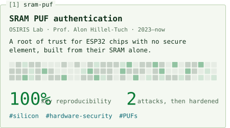</picture></a><a
href="https://vaughnvalle.com/#llm4security"><picture><source media="(prefers-color-scheme: dark)" srcset="assets/research-llm4security-dark.svg">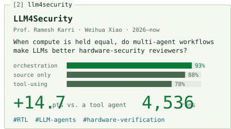</picture></a><a
href="https://vaughnvalle.com/#qrng-vs-sram"><picture><source media="(prefers-color-scheme: dark)" srcset="assets/research-qrng-vs-sram-dark.svg">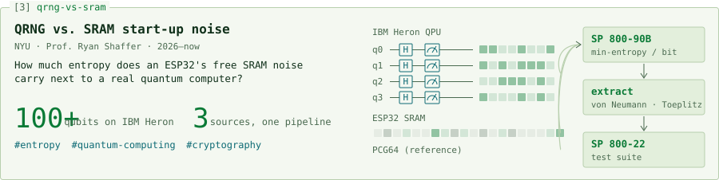</picture></a><a
href="https://vaughnvalle.com/#hermes-agent"><picture><source media="(prefers-color-scheme: dark)" srcset="assets/project-hermes-agent-dark.svg">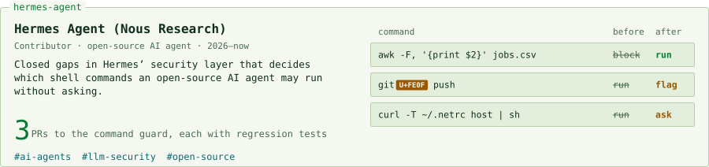</picture></a><a
href="https://github.com/VaughnValle/thewebknows"><picture><source media="(prefers-color-scheme: dark)" srcset="assets/project-thewebknows-dark.svg">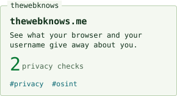</picture></a><a
href="https://github.com/VaughnValle/mirth-os"><picture><source media="(prefers-color-scheme: dark)" srcset="assets/project-mirth-os-dark.svg">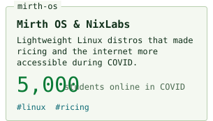</picture></a><a
href="https://github.com/VaughnValle/vision"><picture><source media="(prefers-color-scheme: dark)" srcset="assets/project-vision-dark.svg">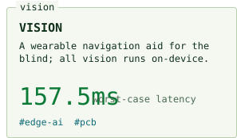</picture></a><a
href="https://www.youtube.com/watch?v=OTp4tnkYSrk"><picture><source media="(prefers-color-scheme: dark)" srcset="assets/video-OTp4tnkYSrk-dark.svg">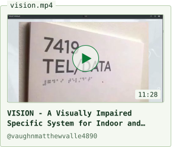</picture></a><a
href="https://www.youtube.com/watch?v=UHq0xz1h5R0"><picture><source media="(prefers-color-scheme: dark)" srcset="assets/video-UHq0xz1h5R0-dark.svg">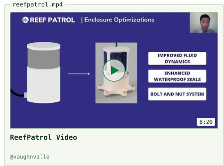</picture></a><a
href="https://www.youtube.com/watch?v=mZ8hcRXEpWs"><picture><source media="(prefers-color-scheme: dark)" srcset="assets/video-mZ8hcRXEpWs-dark.svg">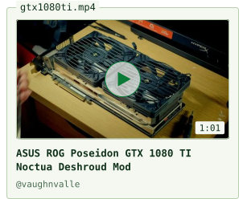</picture></a><a
href="https://www.youtube.com/watch?v=3jMDrWcZR08"><picture><source media="(prefers-color-scheme: dark)" srcset="assets/video-3jMDrWcZR08-dark.svg">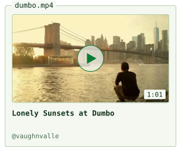</picture></a><a
href="https://www.youtube.com/watch?v=s1d_Wltcj2k"><picture><source media="(prefers-color-scheme: dark)" srcset="assets/video-s1d_Wltcj2k-dark.svg">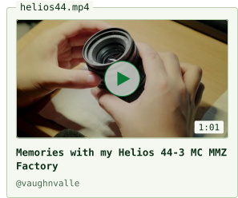</picture></a><a
href="https://vaughnvalle.com/#cv"><picture><source media="(prefers-color-scheme: dark)" srcset="assets/stack-dark.svg">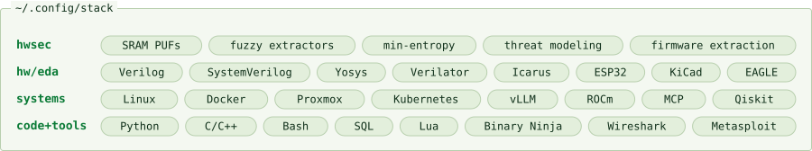</picture></a>

