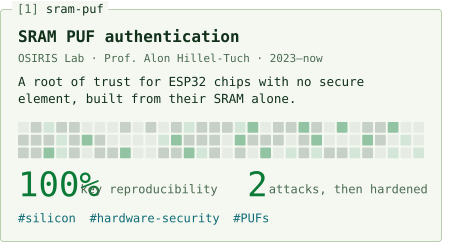
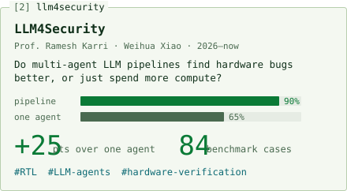
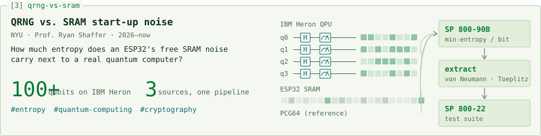
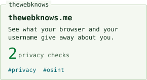
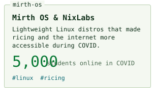
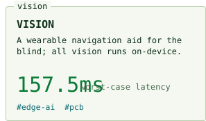
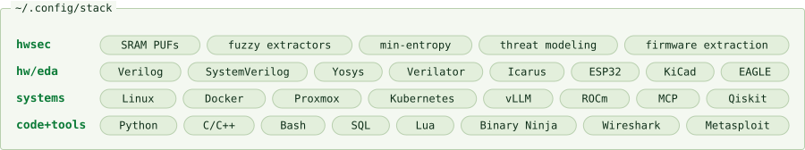

<a href="https://vaughnvalle.com">
  <picture>
    <source media="(prefers-color-scheme: dark)" srcset="assets/hero-dark.svg">
    
  </picture>
</a>

not my commit graph lol: real SRAM power-up bits from my ESP32 (masked), replaying 10 cold boots after an hour in my freezer

<a href="https://vaughnvalle.com"><picture><source media="(prefers-color-scheme: dark)" srcset="assets/link-site-dark.svg"></picture></a>
<a href="https://vaughnvalle.com/cv.pdf"><picture><source media="(prefers-color-scheme: dark)" srcset="assets/link-cv-dark.svg"></picture></a>
<a href="https://scholar.google.com/citations?user=axUk0aMAAAAJ&hl=en"><picture><source media="(prefers-color-scheme: dark)" srcset="assets/link-scholar-dark.svg"></picture></a>
<a href="https://orcid.org/0009-0009-6257-6041"><picture><source media="(prefers-color-scheme: dark)" srcset="assets/link-orcid-dark.svg"></picture></a>
<a href="https://www.linkedin.com/in/vaughnvalle/"><picture><source media="(prefers-color-scheme: dark)" srcset="assets/link-linkedin-dark.svg"></picture></a>
<a href="https://www.youtube.com/@sudo_rice"><picture><source media="(prefers-color-scheme: dark)" srcset="assets/link-youtube-dark.svg"></picture></a>
<a href="mailto:vaughnmv@pm.me"><picture><source media="(prefers-color-scheme: dark)" srcset="assets/link-email-dark.svg"></picture></a>

<a href="https://vaughnvalle.com/#sram-puf"><picture><source media="(prefers-color-scheme: dark)" srcset="assets/research-sram-puf-dark.svg"></picture></a>
<a href="https://vaughnvalle.com/#llm4security"><picture><source media="(prefers-color-scheme: dark)" srcset="assets/research-llm4security-dark.svg"></picture></a>
<a href="https://vaughnvalle.com/#qrng-vs-sram"><picture><source media="(prefers-color-scheme: dark)" srcset="assets/research-qrng-vs-sram-dark.svg"></picture></a>

<a href="https://github.com/VaughnValle/thewebknows"><picture><source media="(prefers-color-scheme: dark)" srcset="assets/project-thewebknows-dark.svg"></picture></a>
<a href="https://github.com/VaughnValle/mirth-os"><picture><source media="(prefers-color-scheme: dark)" srcset="assets/project-mirth-os-dark.svg"></picture></a>
<a href="https://github.com/VaughnValle/vision"><picture><source media="(prefers-color-scheme: dark)" srcset="assets/project-vision-dark.svg"></picture></a>

<picture><source media="(prefers-color-scheme: dark)" srcset="assets/stack-dark.svg"></picture>
